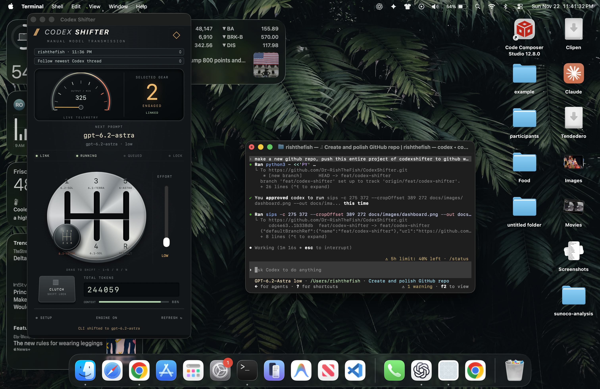
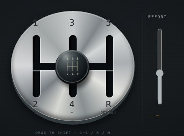

# Codex Shifter

A floating Mac gear shifter for the real Codex terminal CLI. Your prompts, responses, tool output, and approvals stay in your terminal.



## Quick start

On an Apple Silicon Mac with Xcode Command Line Tools and the Codex CLI installed, run these commands from the cloned repository.

```sh
./build.sh
./install.sh
~/.local/bin/codex-shifter
```

## Launch

```sh
codex-shifter
# Or choose a project:
codex-shifter -C ~/your-project
# Resume a saved session:
codex-shifter resume SESSION_ID
```

The command is installed at `~/.local/bin/codex-shifter`. If your terminal does not include that directory in PATH, use that full path. The ordinary `codex` command is unchanged.

## Dashboard controls



- Drag the knob or click gears 1–5 to change the attached CLI's model.
- Move the effort lever to change reasoning effort.
- R selects the catalog's default model. N selects the same default in neutral position.
- Setup assigns models to gears. The catalog and supported effort levels come from your installed Codex.
- Clutch locks model/effort controls against accidental shifts; it does not guarantee prompt-cache preservation.
- Engine On/Off toggles synthesized engine revs, downshift blips, and mechanical gear clunks.
- The diamond pins the dashboard above other windows.
- Select the terminal in the top menu when several are open. Shifter follows the newest loaded Codex thread after `/new`. To target a specific thread, select it in the second menu.
- Closing the dashboard leaves your CLI running. Reopen `Codex Shifter.app` to reconnect.
- Exiting the CLI closes its private local server and removes its temporary session registration.

Model changes apply to subsequent CLI turns. They do not interrupt an answer already in progress. Changes made with the CLI's own `/model` control are reflected in the dashboard.

## How it connects

The launcher starts your installed `codex app-server` on a private Unix socket, then runs the actual `codex --remote unix://…` terminal interface. The dashboard uses `thread/settings/update` to change only model and effort. It never sends keystrokes, prompts, tool calls, or approval decisions. It does not modify your Codex configuration or authentication.

Each launched terminal gets its own socket in a mode-700 temporary directory. Session registration files are private to your macOS account. The dashboard reads token-count records from that session's local rollout; missing data displays a dash. The RPM gauge is an approximate rate from reported output tokens, not an instrumented streaming rate. Context is remaining context capacity, not account quota or credits.

The settings endpoint is experimental and may change in future Codex versions. Tested with this Mac's Codex CLI 0.167.1. The build targets Apple Silicon macOS and uses the existing `/usr/bin/python3` (Xcode Command Line Tools on this Mac). No npm packages, tmux, or API key are required to run it.

The installed launcher points into this source directory, beside the app bundle. Keep both together, or rerun `install.sh` after moving them.

## Build and test

```sh
./build.sh
./install.sh
node --test Tests/*.test.cjs
/usr/bin/python3 -m unittest discover -s Tests -p 'test_*.py' -v
```

The build uses Swift, AppKit, WKWebView, Python's standard library, and a local HTML/CSS dashboard. It is ad-hoc signed for local use, not notarized for distribution.

## Verification

- Native app compiles and code-signature verification passes.
- Gear selection and effort changes were verified against a running terminal CLI.
- A typed CLI draft survived a dashboard model shift and produced `TERMINAL_SHIFTER_OK` after submission.
- Dashboard quit/reopen reattached while the CLI remained running.
- Automated tests cover model capability validation, clutch locking, next-turn payload isolation, default-gear synchronization, disconnected session cleanup, WebSocket framing/fragmentation, and local telemetry parsing.

Inspired by [Model Shifter](https://www.modelshifter.app/); independently implemented for Codex. Interface references: [Codex CLI](https://developers.openai.com/codex/cli/reference) and [Codex app server](https://developers.openai.com/codex/app-server).
